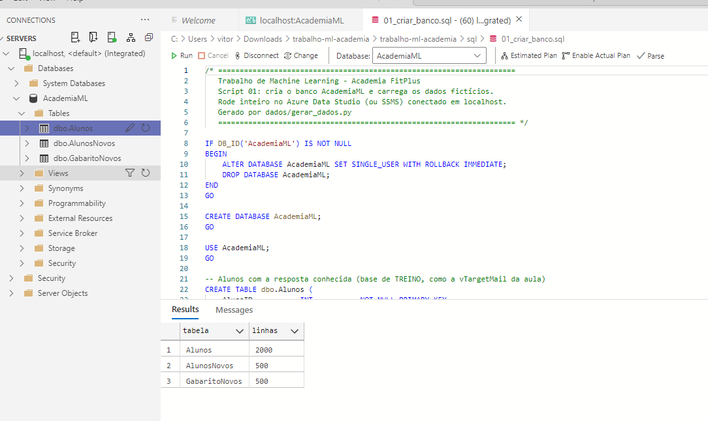
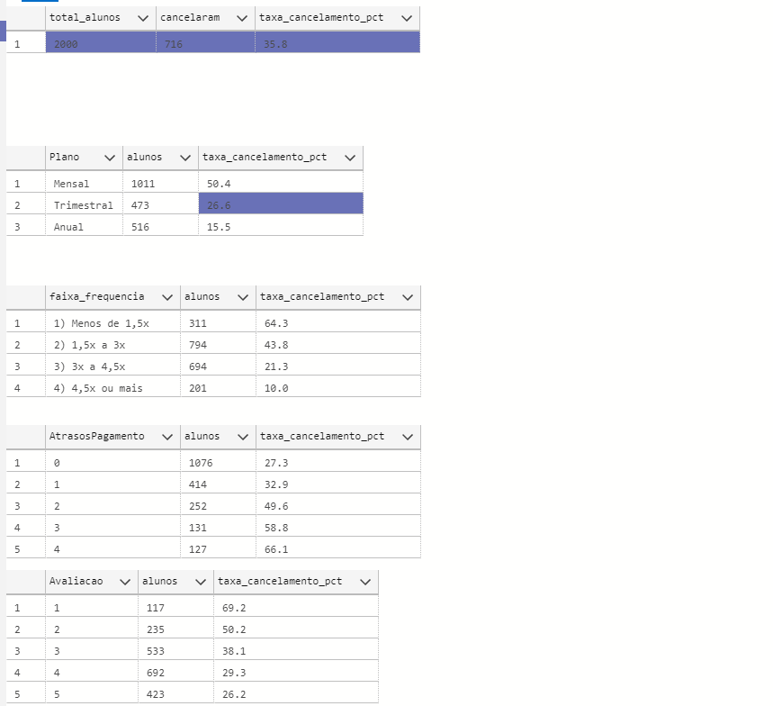
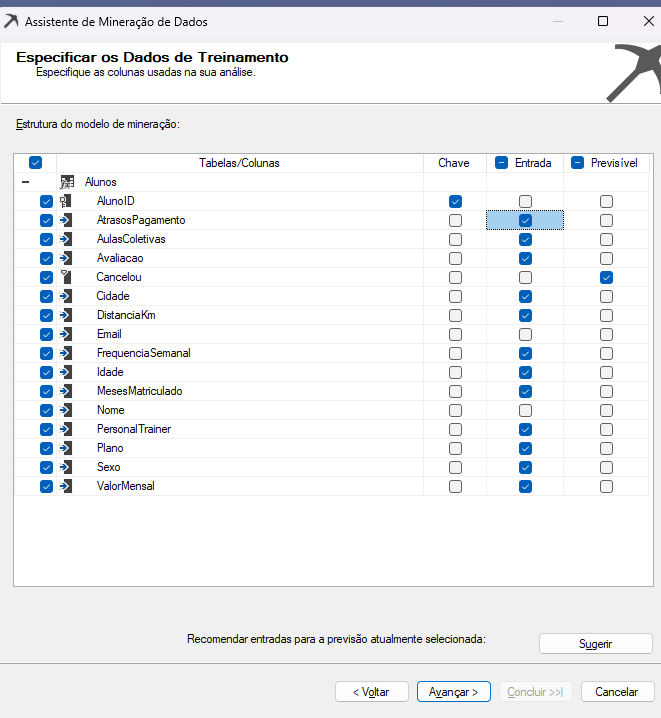
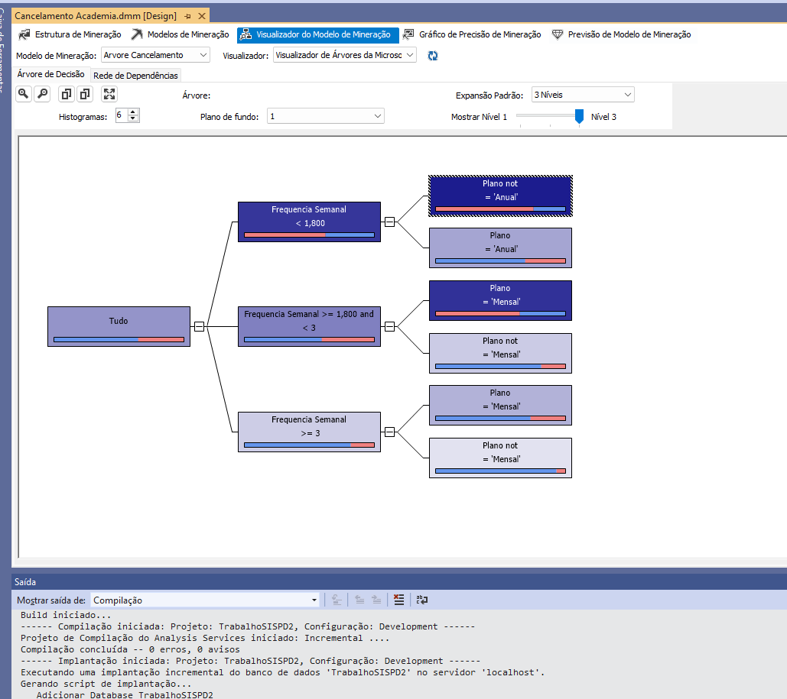
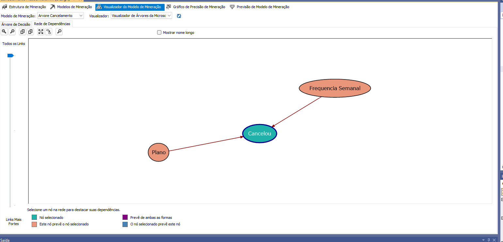
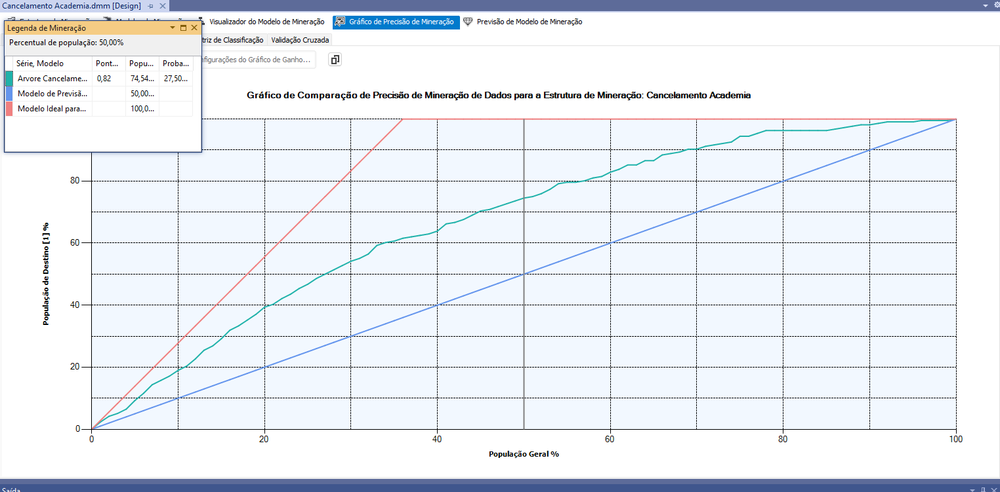
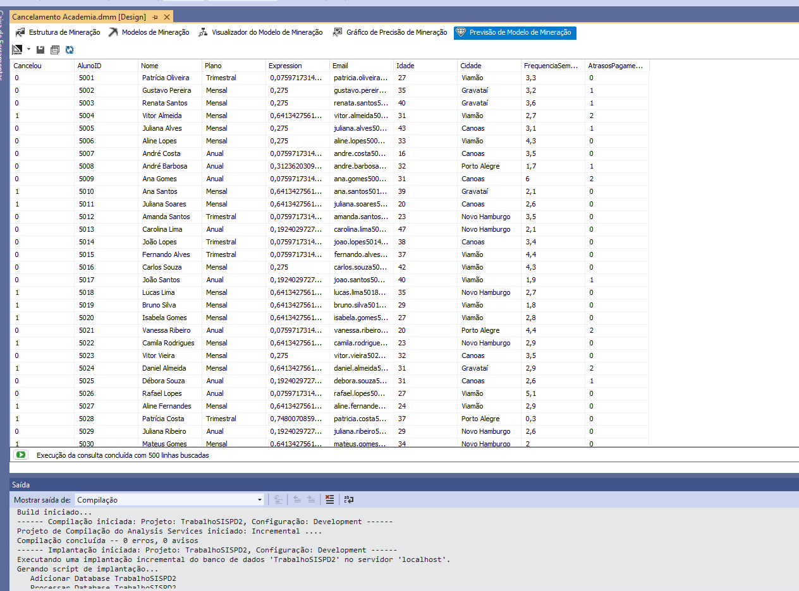
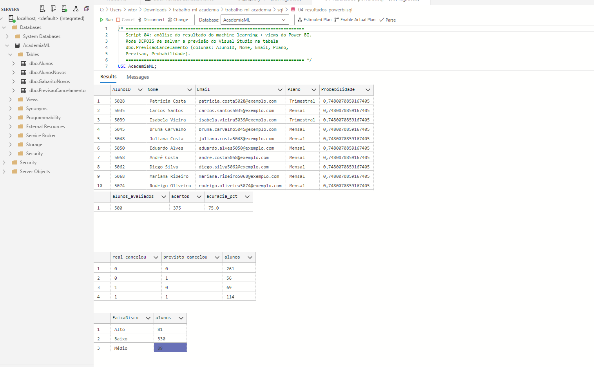
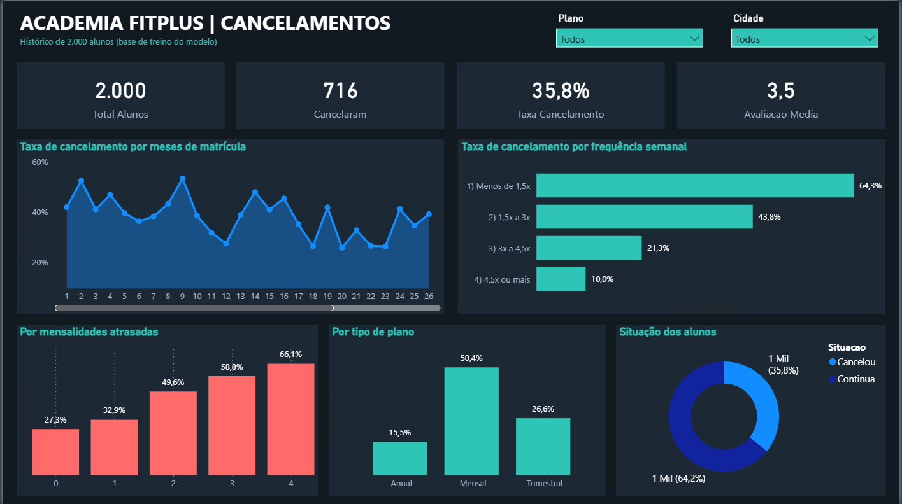
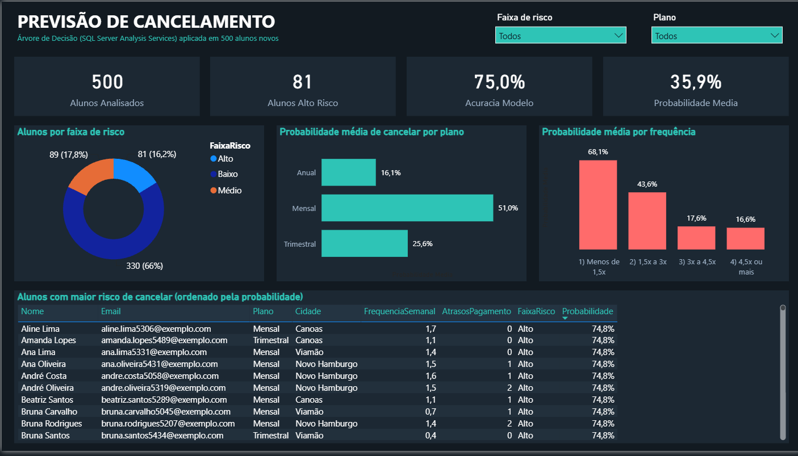

# Previsão de Cancelamento de Alunos com Machine Learning

**Atividade:** Machine Learning – Banco de Dados · **Professor:** Rodrigo Ramos Dornel · **Aluno:** Vitor

Este trabalho usa uma **árvore de decisão do SQL Server Analysis Services** para prever quais alunos de uma academia fictícia (FitPlus) têm mais chance de **cancelar a matrícula**. O resultado vai para um painel no **Power BI**.

| Pedido | O que foi feito |
| --- | --- |
| Definir uma base de dados | Banco **AcademiaML**: 2.000 alunos com histórico e 500 alunos novos (dados fictícios) |
| Definir o tipo de análise | **Classificação**: prever se o aluno cancela (1) ou continua (0) |
| Implementar uma tarefa de ML | **Árvores de Decisão da Microsoft**, treinada no histórico e aplicada nos alunos novos |

---

## 1. Base de dados

| Tabela | Linhas | Uso |
| --- | --- | --- |
| `Alunos` | 2.000 | Treino (tem a resposta `Cancelou`) |
| `AlunosNovos` | 500 | Previsão (sem a resposta) |
| `GabaritoNovos` | 500 | Resposta real dos novos, usada só para medir o acerto |

As colunas de entrada do modelo são: Sexo, Idade, Cidade, Plano, Valor Mensal, Meses Matriculado, Frequência Semanal, Distância, Personal Trainer, Aulas Coletivas, Atrasos de Pagamento e Avaliação. Nome e e-mail não entram no modelo.

## 2. Ferramentas

SQL Server 2019 Developer (Database Engine + Analysis Services no modo **Multidimensional e Mineração de Dados**) · Azure Data Studio · Visual Studio 2019 + Microsoft Analysis Services Projects 2.9.18 · Power BI Desktop.

> A mineração de dados só existe no **SQL Server 2019** (ou anterior) e no **Visual Studio 2019**. Ela foi removida do SQL Server 2022 e das extensões novas do Visual Studio 2022/2026. O passo a passo completo de instalação está em [`docs/PASSO_A_PASSO.md`](docs/PASSO_A_PASSO.md).

## 3. Procedimento

| # | Etapa | Arquivo |
| --- | --- | --- |
| 1 | Criar o banco e carregar os dados | [`sql/01_criar_banco.sql`](sql/01_criar_banco.sql) |
| 2 | Explorar os dados com SQL | [`sql/02_exploracao.sql`](sql/02_exploracao.sql) |
| 3 | Criar a estrutura de mineração no Visual Studio (chave `AlunoID`, previsível `Cancelou`, 12 entradas, 30 % para teste) | projeto Analysis Services |
| 4 | Prever os 500 alunos novos (`PredictProbability`) | [`dmx/03_previsao.dmx`](dmx/03_previsao.dmx) |
| 5 | Medir o acerto e criar as views do Power BI | [`sql/04_resultados_powerbi.sql`](sql/04_resultados_powerbi.sql) |
| 6 | Painel | [`powerbi/Dashboard_Cancelamento.pbip`](powerbi/) |

**Banco criado e exploração dos dados**

**Configuração do modelo e árvore de decisão**

**Rede de dependências e gráfico de precisão (lift chart)**

**Previsão dos alunos novos e acurácia**

## 4. Resultados

| Indicador | Resultado |
| --- | --- |
| Taxa de cancelamento no histórico | **35,8 %** (716 de 2.000) |
| Fatores mais fortes (Rede de Dependências) | **Frequência semanal** e **Plano** |
| Acurácia nos 500 alunos novos | **75,0 %** (375 acertos) |
| Alunos novos com risco alto (probabilidade ≥ 0,70) | **81** |
| Alunos em risco Alto / Médio / Baixo | 81 / 89 / 330 |
| Lift chart | Contatando 50 % dos alunos indicados pelo modelo, a academia alcança **74,5 %** de quem ia cancelar (ao acaso seriam 50 %) |

**Grupos encontrados pela árvore** (treino com 1.400 alunos):

| Grupo | Alunos | Cancelam |
| --- | --- | --- |
| Frequência < 1,8x por semana e plano não anual | 224 | **75 %** |
| Frequência de 1,8x a 3x e plano mensal | 226 | 64 % |
| Frequência < 1,8x e plano anual | 90 | 31 % |
| Frequência ≥ 3x e plano mensal | 339 | 28 % |
| Frequência de 1,8x a 3x e plano não mensal | 241 | 19 % |
| Frequência ≥ 3x e plano não mensal | 280 | **8 %** |

**Matriz de confusão** (500 alunos novos):

| | Previsto: continua | Previsto: cancela |
| --- | --- | --- |
| **Real: continua** | 261 | 56 |
| **Real: cancelou** | 69 | 114 |

## 5. Painel no Power BI

Para abrir: rode o script 04 e abra `powerbi/Dashboard_Cancelamento.pbip`. Se aparecer o aviso de tabelas incompletas, clique em **Atualizar agora**. Os dados vêm de `localhost` / `AcademiaML`.

## 6. Análise e conclusão

- **Frequência é o principal sinal de cancelamento.** Quem vai menos de 1,8 vez por semana cancela muito mais. A taxa cai de 64 % para 10 % entre a menor e a maior faixa de frequência.
- **O plano mensal aumenta o risco.** Ele tem 50 % de cancelamento, contra 15,5 % do anual. Na árvore, o plano é o segundo corte, logo depois da frequência.
- **Atrasos de pagamento e nota baixa também pesam.** Com 4 atrasos, a taxa de cancelamento chega a 66 %, e com nota 1 chega a 69 %. A árvore usou só os dois fatores mais fortes.
- **O modelo acerta 75 % dos alunos novos.** Ele é bem melhor que escolher ao acaso, como mostra o lift chart.

**Uso prático:** a lista dos 81 alunos de risco alto, com nome e e-mail, permite à academia agir antes do cancelamento. Algumas ações possíveis: contato, incentivo à frequência ou oferta de troca do plano mensal para trimestral ou anual.

**Limitação:** os dados são fictícios e servem para demonstrar a técnica. Com dados reais, o mesmo processo pode ser repetido sem mudanças.
