# Passo a passo completo (instalação e execução)

**Atividade:** Machine Learning – Banco de Dados
**Professor:** Rodrigo Ramos Dornel
**Aluno:** Vitor

Este trabalho prevê quais alunos de uma academia fictícia (FitPlus) têm mais chance de **cancelar a matrícula**. A previsão usa uma árvore de decisão do SQL Server Analysis Services, criada no Visual Studio, no mesmo modelo da aula de 19/08/2025 (vTargetMail → ProspectiveBuyer). O resultado vai para o Power BI.

---

## 1. Atividade: o que foi pedido e o que foi feito

| Pedido no enunciado | O que foi feito |
| --- | --- |
| Definir uma base de dados | Banco **AcademiaML**, com 2.000 alunos (histórico) e 500 alunos novos, dados fictícios gerados por script |
| Definir o tipo de análise | **Classificação** (aprendizado supervisionado): prever se o aluno cancela (1) ou continua (0) |
| Implementar uma tarefa de Machine Learning | Modelo **Árvores de Decisão da Microsoft** no Analysis Services, treinado com o histórico e aplicado nos alunos novos |

**Pergunta de negócio:** quais alunos novos têm maior risco de cancelar, e o que mais influencia o cancelamento?

---

## 2. Base de dados

O banco **AcademiaML** tem três tabelas:

| Tabela | Linhas | Para que serve | Equivalente na aula |
| --- | --- | --- | --- |
| `dbo.Alunos` | 2.000 | Histórico com a resposta (`Cancelou`). Usada para **treinar** o modelo | vTargetMail |
| `dbo.AlunosNovos` | 500 | Alunos sem a resposta. Usada para **prever** | ProspectiveBuyer |
| `dbo.GabaritoNovos` | 500 | Resposta verdadeira dos alunos novos. Usada só para **conferir o acerto** | – |

### Dicionário de dados

| Coluna | Tipo | Descrição | Uso no modelo |
| --- | --- | --- | --- |
| AlunoID | INT | Código do aluno | Chave |
| Nome, Email | texto | Dados de contato (fictícios, @exemplo.com) | Não usado |
| Sexo | M/F | Sexo do aluno | Entrada |
| Idade | INT | Idade em anos | Entrada |
| Cidade | texto | Cidade onde mora | Entrada |
| Plano | Mensal / Trimestral / Anual | Tipo de plano | Entrada |
| ValorMensal | DECIMAL | Valor pago por mês (R$) | Entrada |
| MesesMatriculado | INT | Há quantos meses é aluno | Entrada |
| FrequenciaSemanal | DECIMAL | Média de idas à academia por semana | Entrada |
| DistanciaKm | DECIMAL | Distância de casa até a academia | Entrada |
| PersonalTrainer | Sim/Não | Tem personal trainer | Entrada |
| AulasColetivas | Sim/Não | Faz aulas coletivas | Entrada |
| AtrasosPagamento | INT | Quantidade de mensalidades atrasadas | Entrada |
| Avaliacao | 1 a 5 | Nota de satisfação dada pelo aluno | Entrada |
| **Cancelou** | 0/1 | 1 = cancelou, 0 = continua | **Previsível (alvo)** |

Os dados foram gerados pelo script [`dados/gerar_dados.py`](../dados/gerar_dados.py). Eles são aleatórios, mas seguem regras realistas (por exemplo, quem frequenta pouco e tem plano mensal cancela mais). Assim o modelo tem um padrão para descobrir. Não é preciso rodar esse script (nem instalar Python): os dados já estão dentro de `sql/01_criar_banco.sql`.

---

## 3. Ferramentas

| Ferramenta | Para que foi usada |
| --- | --- |
| SQL Server 2019 (Database Engine) | Guardar o banco AcademiaML |
| SQL Server 2019 Analysis Services (modo Multidimensional e Mineração de Dados) | Treinar e rodar o modelo de machine learning |
| Azure Data Studio | Criar o banco e rodar as consultas SQL |
| Visual Studio Community 2019 + extensão Microsoft Analysis Services Projects 2.9.18 | Criar o projeto de mineração de dados |
| Power BI Desktop | Painel com os resultados |
| GitHub | Entrega do trabalho |

---

## 4. Estrutura do repositório

```
trabalho-ml-academia/
├── README.md                     ← esta documentação
├── dados/
│   ├── gerar_dados.py            ← script que gera os dados fictícios
│   ├── alunos.csv                ← 2.000 alunos (treino)
│   ├── alunos_novos.csv          ← 500 alunos (previsão)
│   └── gabarito_novos.csv        ← resposta verdadeira dos 500
├── sql/
│   ├── 01_criar_banco.sql        ← cria o banco e carrega os dados
│   ├── 02_exploracao.sql         ← análises antes do ML
│   └── 04_resultados_powerbi.sql ← acerto do modelo + views do Power BI
├── dmx/
│   └── 03_previsao.dmx           ← consulta de previsão do modelo
├── powerbi/
│   ├── Dashboard_Cancelamento.pbip           ← abre o painel no Power BI Desktop
│   ├── Dashboard_Cancelamento.Report/        ← páginas e gráficos (formato PBIR)
│   └── Dashboard_Cancelamento.SemanticModel/ ← tabelas, medidas DAX e dados em cache
└── prints/                       ← prints de cada etapa
```

---

## 5. Passo a passo

### 5.1 Preparar o ambiente (instalação do zero no Windows)

**Antes de começar:**
- Windows 10 ou 11 de 64 bits.
- Pelo menos 8 GB de memória e 25 GB livres no disco.
- Uma conta Microsoft (Hotmail/Outlook), gratuita.
- Instale na ordem abaixo e reinicie o computador quando o instalador pedir.

> **Importante:** use o **SQL Server 2019**. A mineração de dados (o machine learning usado neste trabalho) foi removida do Analysis Services a partir do SQL Server 2022. Não use a edição **Express**: ela não traz o Analysis Services.

#### 1) SQL Server 2019 (banco de dados + Analysis Services)

1. Baixe o instalador na página oficial do SQL Server 2019 no **Microsoft Evaluation Center**.
2. Abra o instalador e escolha **Baixar Mídia** (ISO). Depois abra o arquivo ISO com dois cliques e execute o **setup.exe**.
   - Se aparecer só o instalador simples, clique em **Personalizado**.
3. No **SQL Server Installation Center**, clique em **Instalação > Nova instalação autônoma do SQL Server**.
4. Na tela **Chave do Produto**, escolha a edição gratuita **Developer**.
5. Aceite a licença e avance até **Seleção de Recursos**. Marque:
   - **Serviços de Mecanismo de Banco de Dados**
   - **Analysis Services**
6. Em **Configuração da Instância**, deixe **Instância padrão** (MSSQLSERVER).
7. Em **Configuração do Mecanismo de Banco de Dados**:
   - Modo de autenticação: **Modo Windows**.
   - Clique em **Adicionar Usuário Atual**.
8. Em **Configuração do Analysis Services**:
   - Modo do servidor: **Modo Multidimensional e de Mineração de Dados**. ⚠️ Essa é a escolha mais importante.
   - Clique em **Adicionar Usuário Atual**.
9. Clique em **Instalar** e aguarde. Todos os itens devem terminar com **Êxito**.

Para conferir: abra o aplicativo **Serviços** do Windows. Os serviços **SQL Server (MSSQLSERVER)** e **SQL Server Analysis Services (MSSQLSERVER)** devem estar **Em execução**.

#### 2) Azure Data Studio (para rodar os scripts SQL)

1. A Microsoft encerrou o Azure Data Studio em 28/02/2026, mas a última versão (1.52) continua disponível para download no GitHub da Microsoft (repositório **microsoft/azuredatastudio**, página **Releases**).
2. Baixe o **User Installer** para Windows (arquivo `.exe`) e instale com as opções padrão.
3. **Se não conseguir baixar ou instalar:** use o **SQL Server Management Studio (SSMS)**, que é gratuito e atual. Os scripts são os mesmos: abra o arquivo e clique em **Executar**.

#### 3) Visual Studio (para o machine learning)

> **Importante:** use o **Visual Studio 2019**. A extensão do Analysis Services para o Visual Studio 2022 e 2026 (versão 4.x, "2022+") **não tem mais a mineração de dados**: o projeto abre, mas a pasta **Estruturas de Mineração** não aparece. O VS 2019 pode ficar instalado junto com versões mais novas.

1. Baixe o instalador do **Visual Studio Community 2019** pelo link oficial `https://aka.ms/vs/16/release/vs_community.exe` (não precisa de assinatura paga).
2. No instalador, marque a carga de trabalho **Processamento e armazenamento de dados** (com **SQL Server Data Tools**) e clique em **Instalar**.
3. Abra o Visual Studio 2019, clique em **Continuar sem código** e vá em **Extensões > Gerenciar Extensões > Online**.
4. Procure **Microsoft Analysis Services Projects** (versão **2.9.18**, sem "2022+" no nome) e clique em **Baixar**.
5. Feche o Visual Studio. O instalador da extensão abre sozinho: clique em **Modify** e aguarde.
6. Para conferir: abra o Visual Studio 2019, clique em **Criar um novo projeto** e procure por **Analysis Services**. Deve aparecer o projeto **Multidimensional e de Mineração de Dados** do Analysis Services.

#### 4) Power BI Desktop

1. Abra a **Microsoft Store**, procure **Power BI Desktop** e clique em **Obter**.

#### 5) Baixar os arquivos do trabalho

1. Extraia o arquivo `trabalho-ml-academia.zip` em uma pasta fácil, por exemplo `C:\TrabalhoML`.

📸 *Opcional:* print da tela final do instalador do SQL Server com tudo em **Êxito** → `prints/00_instalacao.png`

### 5.2 Criar o banco de dados (Azure Data Studio)

1. Abra o **Azure Data Studio** e clique em **New Connection**.
2. Server: `localhost`. Authentication type: **Windows Authentication**. Clique em **Connect**.
   - Se aparecer erro de certificado, marque **Trust server certificate = True**.
3. Menu **File > Open File** e abra `sql/01_criar_banco.sql`.
4. Clique em **Run**. O script apaga o banco AcademiaML se ele já existir, cria de novo, carrega os dados e dá permissão para o Analysis Services usar o banco.
5. A última consulta deve mostrar: Alunos = 2000, AlunosNovos = 500 e GabaritoNovos = 500.
6. Na barra lateral (Servers), clique com o botão direito em **Databases > Refresh**. O banco **AcademiaML** vai aparecer.

📸 **Print 01:** resultado da conferência e o banco aparecendo na lista → `prints/01_banco_criado.png`

### 5.3 Explorar os dados (Azure Data Studio)

1. Abra `sql/02_exploracao.sql` e clique em **Run**.
2. Veja a taxa de cancelamento geral e por plano, por frequência, por atrasos, por avaliação e por personal trainer.
3. Anote as diferenças mais fortes. Elas devem aparecer de novo na árvore de decisão.

📸 **Print 02:** visão geral e cancelamento por plano, frequência, atrasos e avaliação → `prints/02_exploracao_plano.png`
📸 **Print 03:** cancelamento por avaliação e por personal trainer → `prints/03_exploracao_frequencia.png`

### 5.4 Criar o modelo de Machine Learning (Visual Studio)

**a) Projeto**
1. Abra o Visual Studio 2019 e clique em **Criar um novo projeto**.
2. Escolha o projeto **Multidimensional e de Mineração de Dados** do Analysis Services (não o "de Tabela"). Nome usado neste trabalho: `TrabalhoSISPD2`. Clique em **Criar**.

**b) Fonte de dados**
1. No Gerenciador de Soluções, clique com o botão direito em **Fontes de Dados > Nova Fonte de Dados** e depois em **Avançar**.
2. Clique em **Nova...**. Nome do servidor: `localhost`. Autenticação: Windows. Banco: **AcademiaML**. Clique em **OK** e depois em **Avançar**.
3. Em **Informações sobre Representação**, marque **Usar a conta de serviço** e clique em **Avançar**. O script `01_criar_banco.sql` já deu permissão para essa conta ler e gravar no banco.
   - Se der erro de login mais adiante, volte aqui e escolha **Usar um nome de usuário e uma senha específicos do Windows**, com o seu usuário e a sua senha do Windows.
4. Nome da fonte de dados: **Academia ML**. Clique em **Concluir**.

**c) Exibição da fonte de dados**
1. Clique com o botão direito em **Exibições da Fonte de Dados > Nova Exibição da Fonte de Dados**.
2. Escolha a fonte **Academia ML**.
3. Passe as tabelas **Alunos** e **AlunosNovos** para "Objetos incluídos" e clique em **Concluir**.

**d) Estrutura e modelo de mineração**
1. Clique com o botão direito em **Estruturas de Mineração > Nova Estrutura de Mineração** e depois em **Avançar**.
2. Escolha **Do banco de dados relacional ou data warehouse existente**.
3. Escolha **Criar estrutura de mineração com um modelo de mineração**. Técnica: **Árvores de Decisão da Microsoft**.
4. Exibição da fonte de dados: **AcademiaML**.
5. Em **Especificar Tipos de Tabelas**, marque **Alunos** como **Caso**.
6. Em **Especificar os Dados de Treinamento**:
   - `AlunoID` = **Chave**.
   - `Cancelou` = **Previsível**.
   - Marque **Entrada** nas outras 12 colunas (todas menos Nome e Email).
   - Confira se Nome e Email ficaram **desmarcados**.
7. Em **Especificar Conteúdo e Tipo de Dados das Colunas**, clique em **Detectar**. Confira se **Cancelou** está como **Discrete** e mude **Meses Matriculado** para **Continuous**.
8. Em **Criar Conjunto de Testes**, mantenha **30%**.
9. Nome da estrutura: `Cancelamento Academia`. Nome do modelo: `Arvore Cancelamento`. Marque **Permitir detalhamento** e clique em **Concluir**.
10. Clique em **Iniciar** (F5) para implantar e processar. Aguarde a mensagem de que o processamento terminou com sucesso.

📸 **Print 04:** tela "Especificar os Dados de Treinamento" (Chave, Entrada, Previsível) → `prints/04_dados_treinamento.png`

**e) Ler o resultado do modelo**
1. Aba **Visualizador do Modelo de Mineração**. Árvore: **Cancelou**. Plano de fundo: **1**. Os nós mais escuros são os grupos que mais cancelam.
2. Clique nos nós e veja a **Legenda de Mineração** (total de casos e % de cancelamento).
3. Aba **Rede de Dependências**: arraste a barra lateral para baixo e veja quais atributos influenciam mais.
4. Aba **Gráfico de Precisão de Mineração**:
   - **Gráfico de Comparação de Precisão** (lift chart): compare o modelo com a linha ideal e com a aleatória.
   - **Matriz de Classificação**: acertos e erros no conjunto de teste (30%).

📸 **Print 05:** árvore de decisão com a legenda → `prints/05_arvore_decisao.png`
📸 **Print 06:** rede de dependências → `prints/06_rede_dependencias.png`
📸 **Print 07:** gráfico de precisão (lift chart) → `prints/07_lift_chart.png`

### 5.5 Prever os alunos novos e salvar o resultado (Visual Studio)

1. Abra a aba **Previsão de Modelo de Mineração**.
2. Em **Selecionar Modelo**, escolha **Arvore Cancelamento**.
3. Em **Selecionar Tabela de Casos**, escolha **AlunosNovos**. As linhas que ligam as colunas aparecem sozinhas.
4. Preencha a grade de baixo:

| Origem | Campo | Alias | Critérios/Argumento |
| --- | --- | --- | --- |
| AlunosNovos | AlunoID | | |
| AlunosNovos | Nome | | |
| AlunosNovos | Email | | |
| AlunosNovos | Plano | | |
| Arvore Cancelamento | Cancelou | Previsao | |
| Função de Previsão | PredictProbability | Probabilidade | `[Arvore Cancelamento].[Cancelou],1` |

5. Clique no botão de alternar para a exibição **Resultado** e veja a probabilidade de cada aluno.
6. Clique em **Salvar Resultado da Consulta** (ícone de disquete):
   - Fonte de dados: **Academia ML**.
   - Tabela: `PrevisaoCancelamento`.
   - Marque **Substituir se existir** e clique em **Salvar**.

O mesmo comando em DMX está em [`dmx/03_previsao.dmx`](../dmx/03_previsao.dmx).

📸 **Print 08:** grade de previsão e resultado com as probabilidades → `prints/08_previsao.png`

### 5.6 Analisar o resultado (Azure Data Studio)

1. Abra `sql/04_resultados_powerbi.sql` e clique em **Run**.
2. O script mostra três coisas:
   - Os alunos com probabilidade **de 0,70 ou mais** (risco alto). Na aula o corte foi 0,75, mas aqui a maior probabilidade da árvore é 0,748.
   - A **acurácia**, que compara a previsão com a resposta verdadeira.
   - A **matriz de confusão**.
3. O script também cria as views `vw_PowerBI_Previsao` e `vw_PowerBI_Historico`, que alimentam o Power BI.

📸 **Print 09:** alunos com risco alto (>= 0,70) e a acurácia → `prints/09_resultado_sql.png`

### 5.7 Painel no Power BI

O painel está pronto na pasta `powerbi/`, no formato de **projeto do Power BI (.pbip)**. Esse formato guarda o painel em arquivos de texto, o que facilita versionar no GitHub.

1. Rode antes o `sql/04_resultados_powerbi.sql`. Ele cria as views `vw_PowerBI_Historico` e `vw_PowerBI_Previsao`, com as faixas de frequência e de idade usadas nos gráficos.
2. Abra `powerbi/Dashboard_Cancelamento.pbip` com dois cliques.
3. Se aparecer o aviso "Algumas tabelas estão incompletas", clique em **Atualizar agora**. O Power BI lê os dados do banco `AcademiaML` em `localhost` com o usuário do Windows.
4. Para gerar um arquivo único, use **Arquivo > Salvar como** e escolha o tipo **Arquivo do Power BI (*.pbix)**.

**Medidas DAX do modelo:**

```DAX
-- vw_PowerBI_Historico
Total Alunos        = COUNTROWS ( vw_PowerBI_Historico )
Cancelaram          = SUM ( vw_PowerBI_Historico[Cancelou] )
Taxa Cancelamento   = DIVIDE ( [Cancelaram], [Total Alunos] )
Avaliacao Media     = AVERAGE ( vw_PowerBI_Historico[Avaliacao] )

-- vw_PowerBI_Previsao
Alunos Analisados   = COUNTROWS ( vw_PowerBI_Previsao )
Alunos Alto Risco   = CALCULATE ( COUNTROWS ( vw_PowerBI_Previsao ), vw_PowerBI_Previsao[FaixaRisco] = "Alto" )
Acuracia Modelo     = AVERAGEX ( vw_PowerBI_Previsao, IF ( vw_PowerBI_Previsao[Previsao] = vw_PowerBI_Previsao[CancelouReal], 1, 0 ) )
Probabilidade Media = AVERAGE ( vw_PowerBI_Previsao[Probabilidade] )
```

**Página 1 – Histórico** (2.000 alunos):
- Filtros: Plano e Cidade.
- Cartões: Total Alunos, Cancelaram, Taxa Cancelamento, Avaliação Média.
- Área: taxa de cancelamento por meses de matrícula.
- Barras: taxa de cancelamento por faixa de frequência semanal.
- Colunas: taxa de cancelamento por mensalidades atrasadas e por plano.
- Rosca: alunos que cancelaram e que continuam.

**Página 2 – Previsão (ML)** (500 alunos novos):
- Filtros: Faixa de risco e Plano.
- Cartões: Alunos Analisados, Alunos Alto Risco, Acurácia do Modelo, Probabilidade Média.
- Rosca: alunos por faixa de risco (Alto / Médio / Baixo).
- Barras e colunas: probabilidade média de cancelar por plano e por frequência.
- Tabela: nome, e-mail, plano, cidade, frequência, atrasos, faixa de risco e probabilidade, do maior risco para o menor.

📸 **Print 10:** página Histórico → `prints/10_powerbi_historico.png`
📸 **Print 11:** página Previsão → `prints/11_powerbi_previsao.png`

### 5.8 Publicar no GitHub

1. Salve todos os prints na pasta `prints/` com os nomes indicados acima.
2. Preencha as seções **6. Resultados** e **7. Conclusão** deste README com os seus números.
3. No GitHub, abra o repositório (ou crie um em **New repository**, por exemplo `trabalho-ml-academia`).
4. Clique em **Add file > Upload files** e arraste o conteúdo inteiro da pasta `trabalho-ml-academia`.
5. Escreva a mensagem "Entrega do trabalho de Machine Learning" e clique em **Commit changes**.
6. Envie o link do repositório para o professor.

---

## 6. Resultados

| Indicador | Onde obter | Resultado |
| --- | --- | --- |
| Taxa de cancelamento no histórico | Script 02, consulta 1 | 35,8 % (716 de 2.000) |
| Plano que mais cancela | Script 02, consulta 2 | Mensal (50,4 %; Trimestral 26,6 %; Anual 15,5 %) |
| Frequência semanal | Script 02, consulta 3 | Menos de 1,5x: 64,3 %; 4,5x ou mais: 10,0 % |
| Atrasos de pagamento | Script 02, consulta 4 | 0 atrasos: 27,3 %; 4 atrasos: 66,1 % |
| Avaliação (nota) | Script 02, consulta 5 | Nota 1: 69,2 %; nota 5: 26,2 % |
| Personal trainer | Script 02, consulta 6 | Com: 24,1 %; sem: 38,8 % |
| Primeiro atributo da árvore (logo depois de "Tudo") | Visualizador do Modelo | Frequência Semanal (< 1,8 / 1,8 a 3 / 3 ou mais) |
| Atributos mais fortes | Rede de Dependências | Frequência Semanal e Plano |
| Acurácia nos alunos novos | Script 04, consulta 2 | 75,0 % (375 de 500) |
| Alunos novos com probabilidade >= 0,70 | Script 04, consulta 1 | 81 (probabilidade 0,748) |
| Alunos em risco Alto / Médio / Baixo | Script 04, conferência das views | 81 / 89 / 330 |
| Ganho do modelo (lift chart) | Gráfico de Precisão | Contatando 50 % dos alunos indicados pelo modelo, a academia alcança 74,5 % de quem ia cancelar (ao acaso seriam 50 %) |

### O que a árvore de decisão encontrou

A árvore foi treinada com 1.400 alunos (70 % do histórico). Os outros 30 % ficaram para teste.

| Grupo de alunos (nós da árvore) | Alunos | Cancelam |
| --- | --- | --- |
| Todos | 1.400 | 36 % |
| Frequência **menor que 1,8x** por semana e plano **não anual** | 224 | **75 %** |
| Frequência **de 1,8x a 3x** e plano **mensal** | 226 | 64 % |
| Frequência menor que 1,8x e plano anual | 90 | 31 % |
| Frequência 3x ou mais e plano mensal | 339 | 28 % |
| Frequência de 1,8x a 3x e plano não mensal | 241 | 19 % |
| Frequência **3x ou mais** e plano **não mensal** | 280 | **8 %** |

**Matriz de confusão nos 500 alunos novos:**

| | Previsto: continua | Previsto: cancela |
| --- | --- | --- |
| **Real: continua** | 261 | 56 |
| **Real: cancelou** | 69 | 114 |

### Prints

| Etapa | Print |
| --- | --- |
| Banco criado | 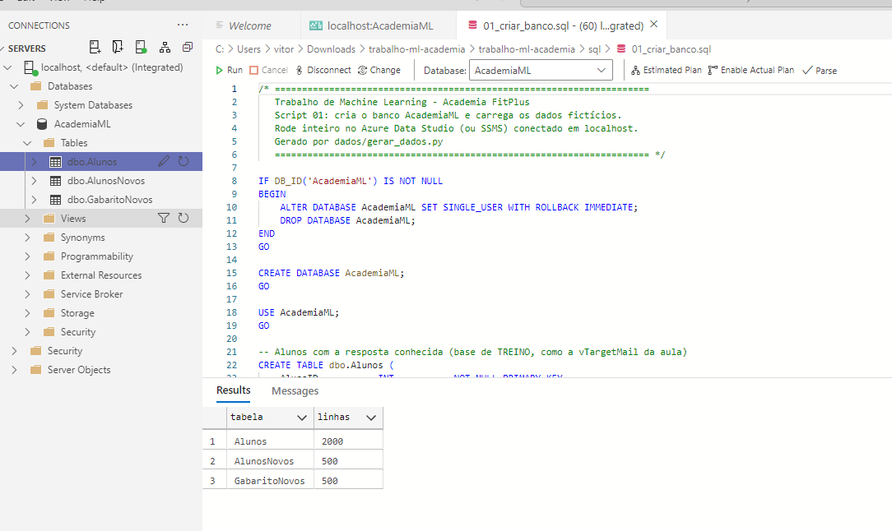 |
| Exploração: plano, frequência, atrasos, avaliação | 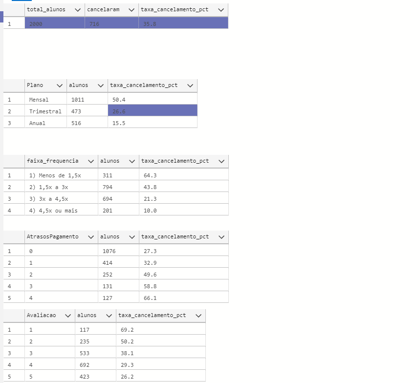 |
| Exploração: avaliação e personal trainer | 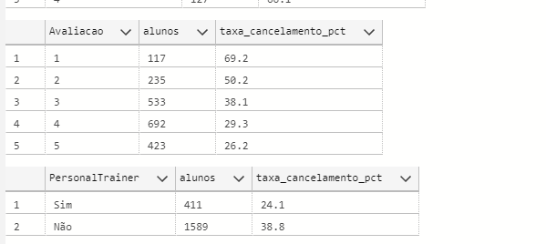 |
| Dados de treinamento | 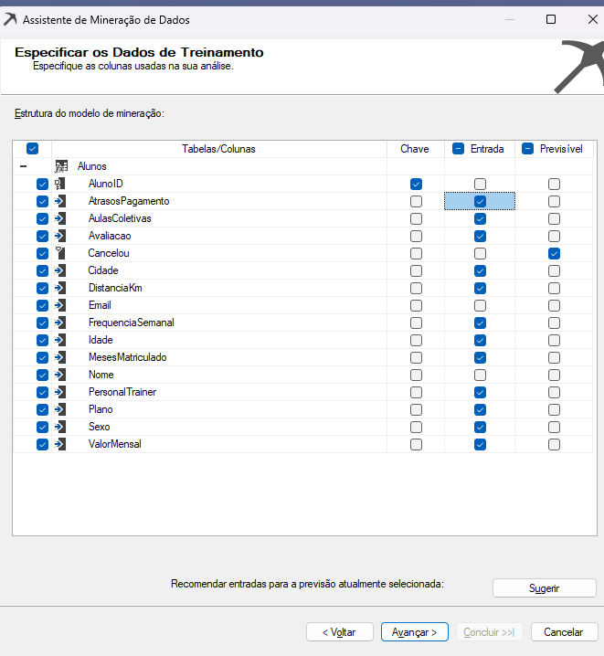 |
| Árvore de decisão | 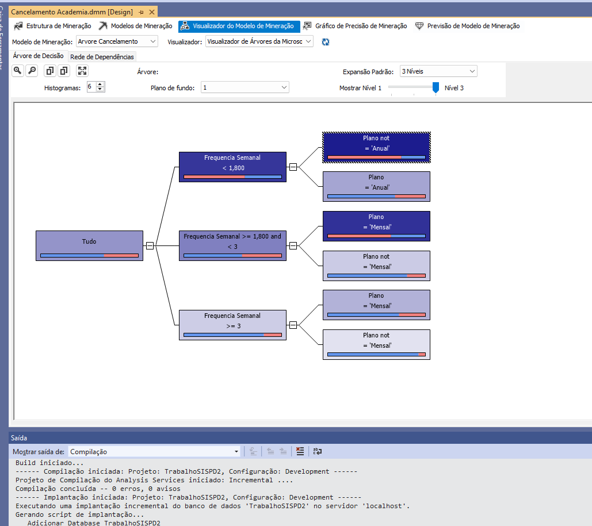 |
| Rede de dependências | 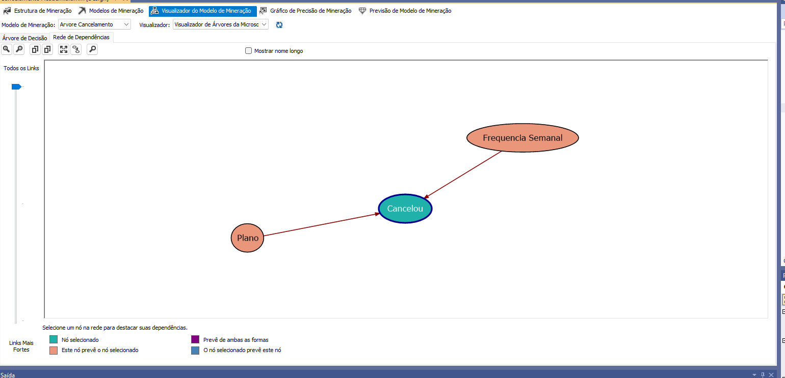 |
| Gráfico de precisão | 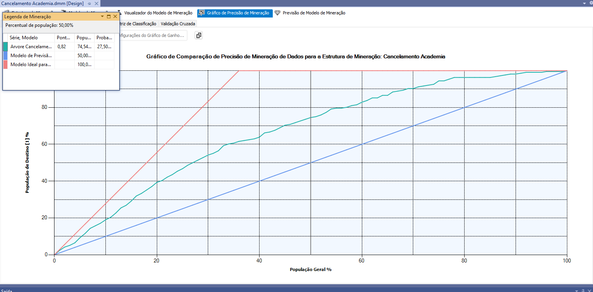 |
| Previsão | 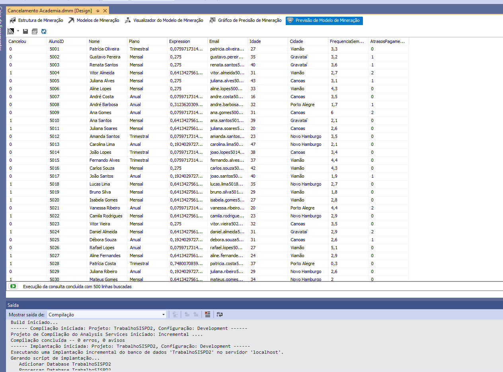 |
| Resultado no SQL | 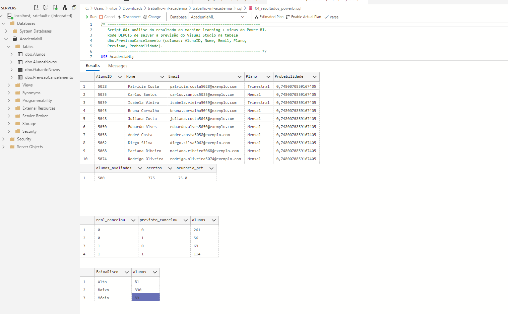 |
| Power BI – Histórico | 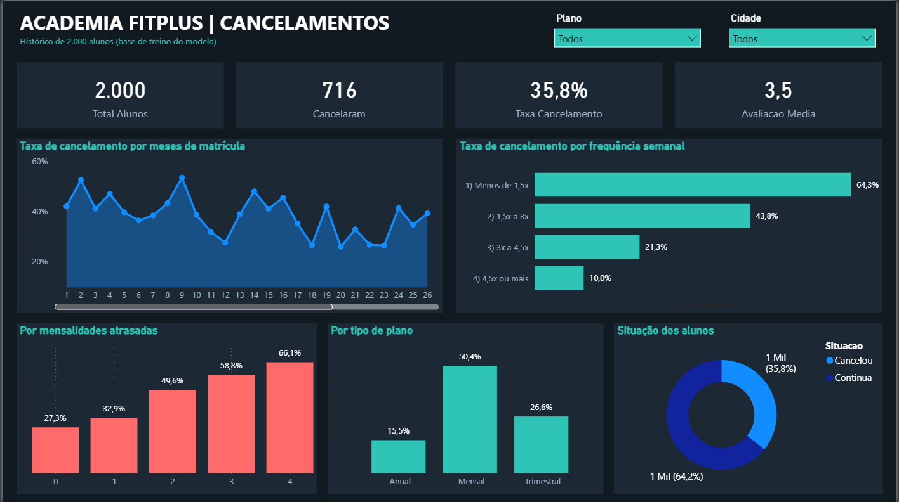 |
| Power BI – Previsão | 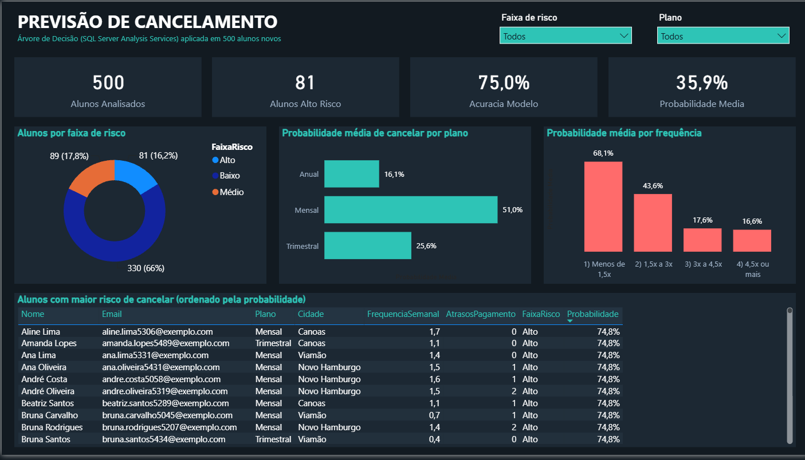 |

---

## 7. Conclusão

O trabalho percorreu o ciclo completo de machine learning dentro do SQL Server:

1. Criar e carregar uma base de dados.
2. Explorar os dados com SQL.
3. Treinar uma árvore de decisão no Analysis Services.
4. Aplicar o modelo em alunos que ele nunca viu.
5. Apresentar o resultado no Power BI.

A árvore mostrou que a **frequência semanal** é o fator que mais separa quem cancela de quem continua, seguida do **tipo de plano**. O aluno que vai menos de 1,8 vez por semana e não tem plano anual cancela em 75 % dos casos. Já quem vai 3 vezes ou mais e não tem plano mensal cancela em só 8 %. No teste com os 500 alunos novos, o modelo acertou **75,0 %** dos casos e apontou **81 alunos de risco alto**. A lista de alunos com risco alto permite que a academia faça uma ação de retenção direcionada (contato, desconto, aula experimental), assim como a aula usou o modelo para escolher os clientes com maior chance de comprar uma bicicleta.

**Limitação:** os dados são fictícios, então o resultado serve para demonstrar a técnica. Com dados reais, o mesmo processo pode ser repetido sem mudanças.
